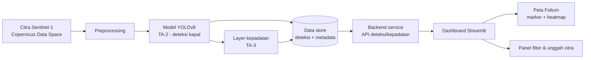
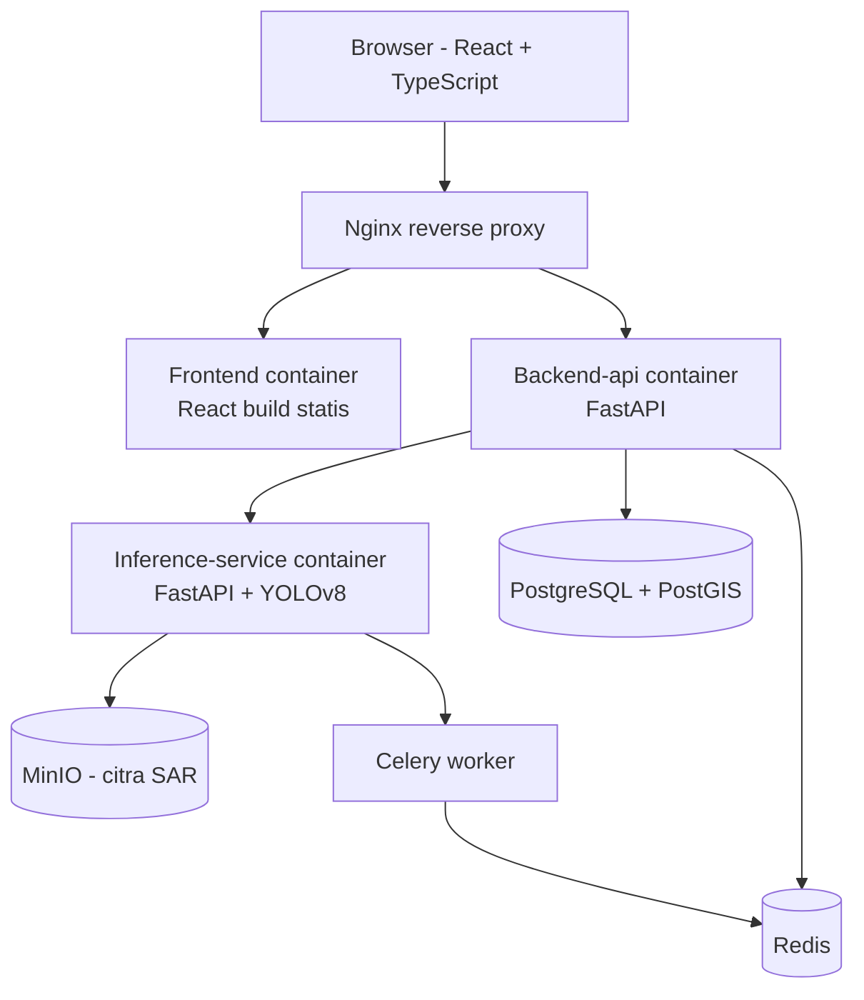

# PRD - Dashboard Monitoring Maritim SAR ALKI II (TA-4)

2026-09-22 · @Someone

Dokumen ini merumuskan kebutuhan produk dan mockup untuk prototipe dashboard monitoring maritim (TA-4) yang mengintegrasikan hasil deteksi kapal SAR (TA-2) dan layer kepadatan (TA-3) ke satu antarmuka berbasis Streamlit dan Folium, untuk segmen Selat Makassar (ALKI II).

## 1. Ringkasan Produk

Dashboard monitoring maritim adalah prototipe web (bukti konsep, TKT 3) yang menyatukan tiga hasil riset payung Riset Konektivitas Nusantara menjadi satu sistem yang bisa dioperasikan pengguna non-teknis: model deteksi kapal SAR (TA-2, YOLOv8 pada citra Sentinel-1) dan layer kepadatan kapal (TA-3) ditampilkan di atas peta interaktif untuk segmen ALKI II di Selat Makassar.

**Masalah yang diselesaikan:** hasil riset deteksi dan analisis spasial saat ini berhenti sebagai artefak akademik terpisah, belum bisa langsung dipakai instansi maritim untuk pengambilan keputusan.

**Solusi:** dashboard Streamlit + Folium yang menampilkan posisi kapal terdeteksi, kepadatan lalu lintas kapal, dan metadata citra SAR sumber, dengan pembaruan near real-time mengikuti ketersediaan citra Sentinel-1 baru (bukan streaming kontinu — lihat batasan di §3 dan §6).

## 2. Target Pengguna & Masalah

| Persona | Kebutuhan | Pain point saat ini |
| --- | --- | --- |
| Operator instansi (Bakamla / TNI AL / Polairud) | Melihat posisi & kepadatan kapal di ALKI II tanpa membaca output model mentah | Data deteksi dan analisis spasial tersebar di file/laporan riset terpisah per TA |
| Dosen pembimbing / penguji TA | Menilai kelayakan bukti konsep (TKT 3) dan hasil pengujian | Prototipe akademik jarang diuji formal ke pengguna non-teknis |
| Peneliti hibah induk | Demo hasil integrasi TA-1/2/3 ke calon mitra/instansi | Belum ada antarmuka terpadu untuk didemokan |

Riset menunjukkan pengamanan ALKI II selama ini melibatkan banyak instansi dan belum optimal karena masalah komunikasi serta koordinasi antar personel lintas instansi — dashboard ini diposisikan sebagai titik temu data bersama, bukan sekadar visualisasi teknis.

## 3. Ruang Lingkup

**In-scope**

- Perancangan arsitektur & UI dashboard
- Integrasi output model deteksi TA-2 (bounding box kapal per citra SAR) dan layer kepadatan TA-3
- Peta interaktif Folium: marker kapal, layer kepadatan (heatmap/cluster), filter tanggal citra
- Unggah/pemrosesan citra SAR baru ke pipeline
- Pengujian fungsional black-box dan usability (SUS)

**Out-of-scope**

- Pengembangan atau retraining model deteksi (ranah TA-2)
- Streaming real-time kontinu (dibatasi ketersediaan citra Sentinel-1, lihat §1 dan §6)
- Deployment skala produksi/instansi resmi (di luar TKT 3)

**Risiko & mitigasi (dari brief)**

- Input TA-2/TA-3 telat → bangun UI dengan data dummy dulu, integrasi menyusul
- Scope creep ke fitur produksi → dikunci pada bukti konsep, fitur lanjut masuk roadmap Tahun 2

## 4. Arsitektur Sistem & Alur Data

Mengikuti pola arsitektur tiga lapisan (presentation, business logic, data) dengan modul deteksi diisolasi sebagai service terpisah agar mudah menerima update model dari TA-2 tanpa membongkar dashboard.

Sumber data satelit: Copernicus Data Space Ecosystem atau ASF Vertex (Sentinel-1 GRD/SLC, gratis). Basemap peta: OpenStreetMap (default Folium), opsional overlay OpenSeaMap untuk batas jalur pelayaran ALKI II.

## 5. Spesifikasi Halaman (Mockup)

### 5.1 Halaman Peta Utama (default landing)

- Peta Folium full-width, pusat di Selat Makassar (ALKI II)
- Marker per kapal terdeteksi (popup: koordinat, waktu citra, confidence score model)
- Toggle layer: Marker individual / Heatmap kepadatan / Cluster
- Sidebar filter: rentang tanggal citra, area sub-segmen ALKI II
- Badge status data: "Citra terbaru: \[tanggal\] · near real-time"

### 5.2 Halaman Unggah & Proses Citra

- Form unggah citra SAR (atau pilih dari hasil sinkronisasi otomatis Copernicus)
- Progress bar proses deteksi (preprocessing → inferensi model → hasil)
- Preview hasil bounding box sebelum dipublikasikan ke peta utama

### 5.3 Halaman Detail Deteksi

- Tabel hasil deteksi per citra: ID kapal, koordinat, confidence, waktu
- Grafik ringkas jumlah kapal terdeteksi per periode
- Tombol ekspor data (CSV)

### 5.4 Halaman Tentang / Metodologi

- Penjelasan singkat pipeline TA-1/TA-2/TA-3, sumber data, dan batasan (near real-time, bukan live streaming)
- Kontak/instansi penanggung jawab

Navigasi antar halaman pakai sidebar Streamlit standar; tidak ada halaman login di scope TKT 3 (autentikasi masuk roadmap Tahun 2).

## 6. Kebutuhan Non-Fungsional & Rencana Pengujian

**Non-fungsional**

- Kemudahan pakai: dapat dioperasikan pengguna non-teknis tanpa pelatihan khusus
- Kejujuran klaim waktu: label "near real-time" di UI, bukan "real-time", mengikuti latensi citra Sentinel-1 (1-24 jam tergantung prioritas area, revisit 6-12 hari)
- Modular: layanan deteksi terpisah dari dashboard agar model TA-2 bisa diperbarui tanpa mengubah frontend

**Pengujian fungsional**

- Teknik: Black-box Equivalence Class Partitioning (ECP) — dipilih karena riset pembanding menunjukkan ECP menangkap kegagalan fungsional lebih banyak (51,8%) dibanding Boundary Value Analysis (33,3%) dan Decision Table (46%)
- Cakupan: filter tanggal, unggah citra, toggle layer peta, ekspor data

**Pengujian usability**

- Instrumen: System Usability Scale (SUS), 10 pertanyaan, skor 0-100
- Target: skor minimal masuk kategori "acceptable" (>=68), idealnya grade B ke atas
- Metode: pilot ke sampel responden dari instansi/pembimbing, mengikuti pola think-aloud protocol + kuesioner SUS setelah menyelesaikan skenario tugas

**Metrik keberhasilan** (dari brief): kelengkapan fitur vs kebutuhan, pass rate uji fungsional, skor SUS.

## 7. Referensi Utama

- [AI-Based Ship Recognition System (Streamlit + Folium + YOLOv8 dashboard)](https://zenodo.org/records/19783609)
- [Sentinel-1 near real-time application for maritime situational awareness](https://www.researchgate.net/publication/325800838_Sentinel-1_near_real-time_application_for_maritime_situational_awareness)
- [Sentinel-1 - Data Products - Sentinel Online](https://sentinel.esa.int/web/sentinel/missions/sentinel-1/data-products)
- [Copernicus Data Space Ecosystem](https://dataspace.copernicus.eu/)
- [Perbandingan Teknik Black Box Testing: ECP, BVA, Decision Table](https://journal.ugm.ac.id/v3/JISE/article/download/9446/4209)
- [Analysis of a Web-Based Dashboard to Support the Use of National Audit Data - pola evaluasi SUS untuk dashboard](https://www.sciencedirect.com/org/science/article/pii/S1438887121011420)
- [Kerjasama Pengamanan Alur Laut Kepulauan Indonesia II (Bakamla, TNI, Polairud)](https://www.journal.unpas.ac.id/index.php/paradigmapolistaat/article/view/5500)
- [Pengembangan Platform Web Modular untuk Deteksi, Segmentasi, dan Pelacakan Objek](https://jtech.onlinelibrary.id/index.php/JTDS/article/download/48b50fbf/25/290)

Daftar lengkap referensi lain (dataset, metodologi PXP, dsb.) sudah dibahas di percakapan sebelumnya.

## 8. Tumpukan Teknologi Lengkap (Opsi Arsitektur Full-Stack)

> Catatan: brief resmi TA-4 mensyaratkan prototipe berbasis **Streamlit + Folium** dari dosen pembimbing. Bagian ini adalah opsi arsitektur alternatif yang lebih production-grade pakai React + TypeScript + Docker, untuk eksplorasi atau versi lanjutan pasca-TA (roadmap Tahun 2). Sebaiknya dikonfirmasi dulu ke pembimbing sebelum dijadikan arah utama, karena mengganti tech stack inti berarti keluar dari scope yang sudah disepakati di brief.

### 8.1 Frontend

| Komponen | Pilihan | Alasan |
| --- | --- | --- |
| Framework | React 18 + TypeScript | Type safety, ekosistem luas, cocok untuk dashboard interaktif |
| Build tool | Vite | Dev server cepat, HMR instan, lebih ringan dari CRA |
| Peta interaktif | react-leaflet | Wrapper React untuk Leaflet.js, setara Folium tapi native komponen React |
| Peta alternatif | Mapbox GL JS | Kalau butuh rendering vector tile lebih performan untuk banyak marker |
| State management | Zustand | Ringan, minim boilerplate dibanding Redux |
| Data fetching | TanStack Query (React Query) | Caching & refetch otomatis data deteksi kapal |
| UI komponen | Tailwind CSS + shadcn/ui | Komponen siap pakai (card, table, dialog), konsisten dengan styling |
| Chart | Recharts | Grafik jumlah kapal terdeteksi per periode |
| Testing | Vitest + React Testing Library | Unit test komponen, terintegrasi cepat dengan Vite |

### 8.2 Backend

| Komponen | Pilihan | Alasan |
| --- | --- | --- |
| Framework API | FastAPI (Python) | Model YOLOv8 juga Python, satu bahasa untuk inference & API, kurangi overhead serialisasi antar-bahasa |
| Validasi data | Pydantic (bawaan FastAPI) | Skema request/response otomatis tervalidasi + dokumentasi OpenAPI gratis |
| Autentikasi (roadmap Tahun 2) | OAuth2PasswordBearer + JWT | Standar FastAPI, cukup ringan untuk skala instansi |
| Task queue (opsional) | Celery + Redis broker | Supaya upload citra besar tidak blocking request utama |
| Web server | Uvicorn (ASGI) | Server produksi standar untuk FastAPI, mendukung async |

**Pembagian service (mengikuti pola arsitektur modular di §4):**

- **Inference service** — terima citra SAR, jalankan YOLOv8, kembalikan bounding box + confidence (endpoint async, antre lewat Celery kalau volume tinggi)
- **Data service** — CRUD data deteksi, kepadatan, metadata citra; query berdasarkan filter tanggal/area
- Kedua service bisa jalan sebagai container Docker terpisah (lihat §8.4) supaya model TA-2 bisa di-update tanpa redeploy data service

### 8.3 Database & Penyimpanan

| Komponen | Pilihan | Alasan |
| --- | --- | --- |
| Database utama | PostgreSQL + PostGIS | Ekstensi PostGIS mendukung tipe data geometri (titik/poligon) — pas untuk koordinat kapal & batas ALKI II |
| Cache | Redis | Cache hasil query yang sering diakses (peta default) + broker Celery |
| Object storage citra | MinIO (self-hosted, kompatibel S3 API) | Simpan citra SAR mentah/besar tanpa membebani database relasional |
| Migrasi skema | Alembic | Version control skema database, standar untuk FastAPI + SQLAlchemy |

### 8.4 Containerization & Deployment

- **Docker**: satu image per service — `frontend`, `backend-api`, `inference-service`, `postgres`, `redis`, `nginx`
- **docker-compose.yml**: orkestrasi lokal untuk development, mendefinisikan network internal antar service supaya tidak perlu expose port database ke luar
- **Reverse proxy**: Nginx di depan — routing `/api/*` ke backend-api, `/` ke build statis React
- **CI/CD**: GitHub Actions — build image, jalankan test (Vitest untuk frontend, pytest untuk backend), push ke registry (GHCR) tiap push ke branch main
- **Deployment**: VPS (contoh: DigitalOcean, Biznet Gio) menjalankan `docker-compose up` langsung — cukup untuk skala demo TKT 3; Kubernetes kemungkinan berlebihan untuk scope ini

### 8.5 Contoh Struktur Endpoint API

| Endpoint | Method | Deskripsi |
| --- | --- | --- |
| `/api/detections` | GET | Daftar deteksi kapal, filter by tanggal/area |
| `/api/detections/export` | GET | Ekspor data deteksi ke CSV |
| `/api/images` | POST | Unggah citra SAR baru untuk diproses |
| `/api/images/{id}/status` | GET | Cek status pemrosesan citra (queued/processing/done) |
| `/api/density` | GET | Data layer kepadatan kapal per grid area |
| `/api/health` | GET | Health check untuk tiap service (dipakai Docker healthcheck) |

### 8.6 Diagram Container (ringkas)

Semua service di atas didefinisikan sebagai service terpisah di `docker-compose.yml`, sehingga tiap bagian (frontend, inference, data) bisa di-scale atau di-redeploy independen — selaras dengan argumen modularitas di §4.
