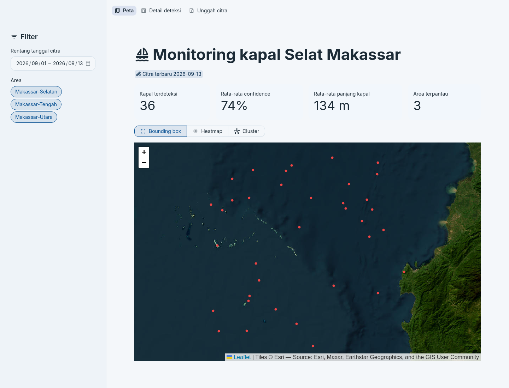
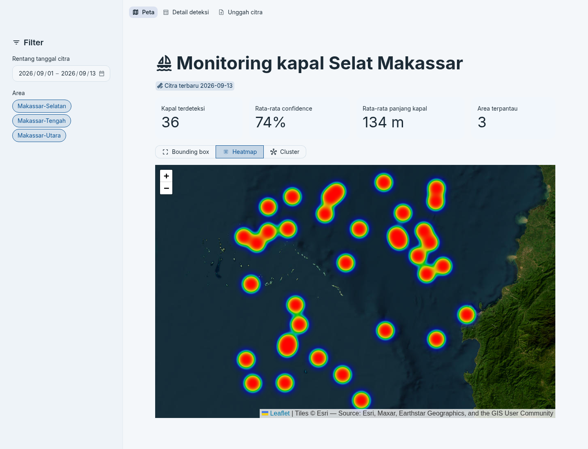
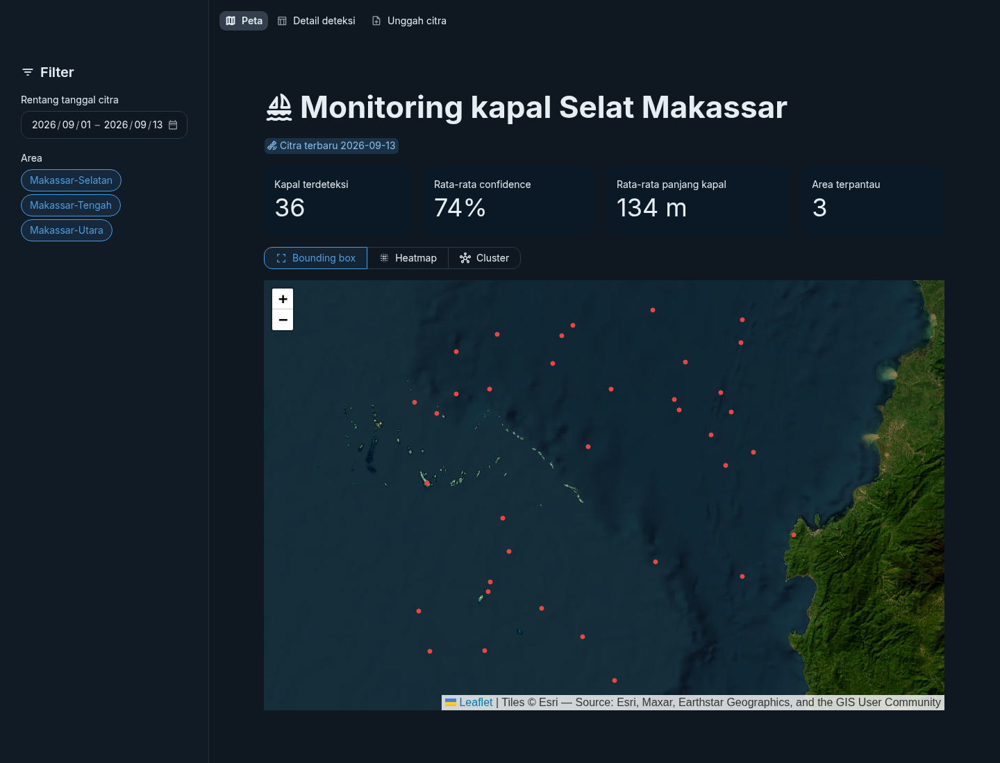

# Dashboard Monitoring Maritim ALKI II

[](https://github.com/user312982/penelitian-maritim/actions/workflows/lint.yml)
[](https://github.com/user312982/penelitian-maritim/actions/workflows/tests.yml)


Dashboard web untuk memantau hasil deteksi kapal dari citra satelit radar Sentinel-1 (SAR) di Selat Makassar (ALKI II), ditampilkan di atas peta satelit interaktif.



> Data deteksi saat ini masih dummy ([`data/dummy_detections.csv`](data/dummy_detections.csv)) dan proses deteksi di halaman unggah masih disimulasikan.

## Fitur

- **Peta interaktif** dengan tiga mode tampilan: bounding box kapal, heatmap kepadatan, dan cluster
- **Filter** rentang tanggal citra dan area, plus ringkasan KPI yang ikut berubah
- **Detail deteksi**: grafik per tanggal dan per area, tabel lengkap, ekspor CSV
- **Unggah citra**: proses citra lalu publikasikan hasil deteksinya ke peta
- **Mode terang dan gelap** mengikuti pengaturan sistem

| Bounding box | Heatmap | Cluster |
| --- | --- | --- |
|  |  |  |

| Detail deteksi | Unggah citra | Mode gelap |
| --- | --- | --- |
|  |  |  |

## Tech stack

| Bagian | Teknologi |
| --- | --- |
| Bahasa | Python 3.10+ |
| Web app | [Streamlit](https://streamlit.io) |
| Peta | [Folium](https://python-visualization.github.io/folium/) (Leaflet) + `streamlit-folium` |
| Basemap | Esri World Imagery (citra satelit) |
| Data | pandas |
| Testing | pytest |
| Linting | flake8 |
| CI | GitHub Actions |

## Menjalankan

```bash
python -m venv venv
source venv/bin/activate          # Windows: venv\Scripts\activate
pip install -r requirements.txt
streamlit run app.py
```

Buka http://localhost:8501.

## Testing

```bash
pytest     # unit test
flake8     # linting
```

## Struktur folder

```
.
├── app.py               # Entry point + navigasi
├── app_pages/           # Halaman: peta, detail, unggah
├── lib/                 # Logika data dan peta
├── data/                # Data deteksi (CSV)
├── images/              # Screenshot dashboard
├── scripts/             # Script screenshot otomatis
├── tests/               # Unit test
├── docs/                # Dokumen perancangan
└── .streamlit/          # Tema
```

## Format data

Setiap baris di CSV adalah satu kapal terdeteksi:

| Kolom | Keterangan | Contoh |
| --- | --- | --- |
| `id` | ID deteksi | `KPL-001` |
| `lat`, `lon` | Koordinat | `-2.5489`, `118.0149` |
| `waktu_citra` | Tanggal citra | `2026-09-15` |
| `confidence` | Keyakinan model (0–1) | `0.87` |
| `area` | Sub-segmen area | `Makassar-Utara` |
| `length_m`, `width_m` | Ukuran kapal (meter) | `189.4`, `30.4` |
