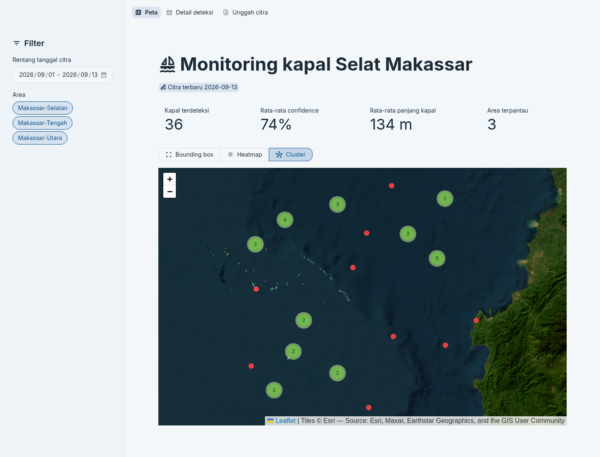
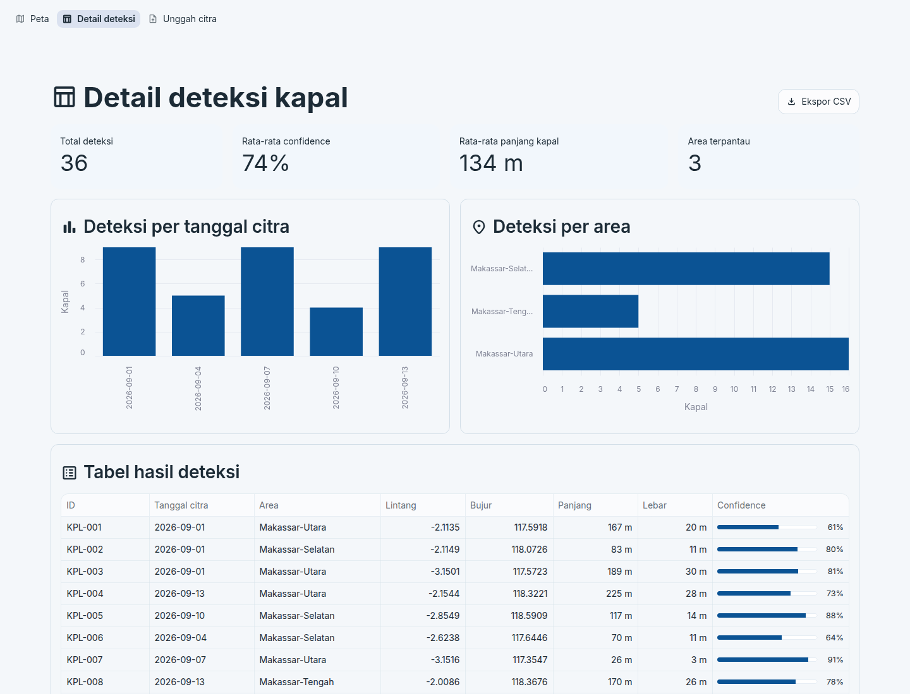
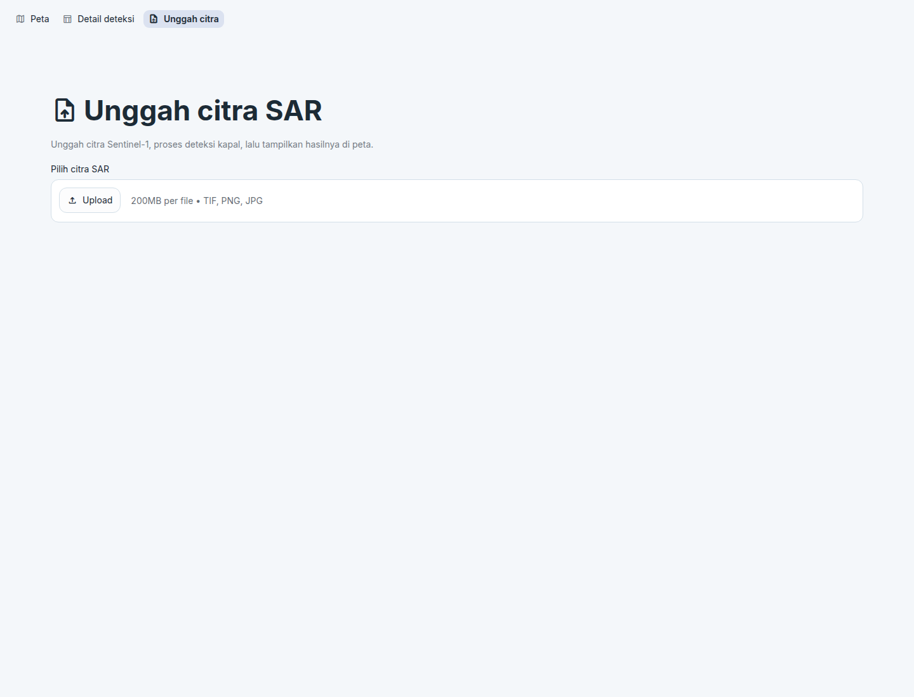
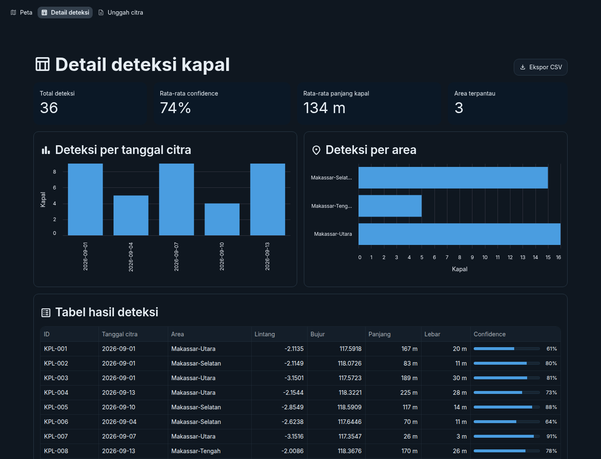

# Dashboard Monitoring Maritim SAR ALKI II

Prototipe dashboard web (bukti konsep, **TKT 3**) yang menampilkan hasil deteksi kapal dari citra radar **Sentinel-1 SAR** dan kepadatan lalu lintas kapal di **Alur Laut Kepulauan Indonesia (ALKI) II, Selat Makassar**. Dibangun dengan Streamlit + Folium sebagai bagian TA-4 dari riset payung *Riset Konektivitas Nusantara*.


> **Catatan:** data deteksi saat ini masih **dummy** (`data/dummy_detections.csv`) dengan skema yang sama seperti output model TA-2. Inferensi pada halaman unggah citra masih disimulasikan.

## Posisi dalam riset

| Tahap | Isi |
| --- | --- |
| TA-1 | Pengumpulan & penyiapan citra Sentinel-1 |
| TA-2 | Deteksi kapal dengan YOLOv8 pada citra SAR |
| TA-3 | Analisis spasial / layer kepadatan kapal |
| **TA-4 (repo ini)** | Dashboard yang menyatukan hasil TA-2 & TA-3 di peta interaktif |

## Tampilan

### Peta utama: tiga mode tampilan

| Bounding box | Heatmap kepadatan | Cluster |
| --- | --- | --- |
|  |  |  |

Ringkasan KPI di atas peta ikut berubah sesuai filter (rentang tanggal citra dan area) di sidebar. Bounding box kapal digambar pada skala geografis nyata (meter) dan membesar saat peta di-zoom; titik merah menandai pusat kapal saat zoom jauh.

### Halaman lain

| Detail deteksi | Unggah citra |
| --- | --- |
|  |  |

### Mode gelap

| Peta utama | Detail deteksi |
| --- | --- |
|  |  |

Semua gambar ada di folder [`images/`](images/) dan bebas dipakai untuk laporan atau presentasi.

## Menjalankan

Butuh Python 3.10+.

```bash
python -m venv venv
source venv/bin/activate          # Windows: venv\Scripts\activate
pip install -r requirements.txt
streamlit run app.py
```

Buka http://localhost:8501.

## Mengambil ulang gambar dari web

Script [`scripts/screenshot.py`](scripts/screenshot.py) menjalankan app, membuka tiap halaman di browser headless (mode terang dan gelap), lalu menyimpan screenshot ke `images/`.

```bash
pip install playwright
playwright install chromium       # lewati jika Google Chrome sudah terpasang
python scripts/screenshot.py
```

Jika app sudah berjalan, pakai `python scripts/screenshot.py --url http://localhost:8501`. Butuh koneksi internet karena tile satelit dimuat dari Esri.

## Pengujian

```bash
pytest
```

Unit test mencakup logika data (`lib/data.py`) dan pembangun peta (`lib/map.py`).

## Struktur repo

```
.
├── app.py                  # Entry point + navigasi
├── app_pages/
│   ├── peta.py             # Peta utama + KPI
│   ├── detail.py           # Grafik & tabel deteksi, ekspor CSV
│   └── unggah.py           # Unggah citra & publikasi hasil ke peta
├── lib/
│   ├── data.py             # Load, filter & agregasi data deteksi
│   ├── map.py              # Peta Folium: bounding box, heatmap, cluster
│   └── style.py            # CSS efek glass
├── data/                   # Data deteksi dummy (CSV)
├── images/                 # Screenshot dashboard
├── scripts/screenshot.py   # Ambil screenshot otomatis
├── tests/                  # Unit test pytest
├── docs/                   # PRD, SPEC, rencana implementasi
├── .streamlit/config.toml  # Tema terang/gelap, font Inter
└── pytest.ini
```

## Skema data

`data/dummy_detections.csv`. Data real TA-2/TA-3 nantinya cukup mengikuti kolom yang sama:

| Kolom | Tipe | Contoh |
| --- | --- | --- |
| `id` | str | `KPL-001` |
| `lat`, `lon` | float | `-2.5489`, `118.0149` |
| `waktu_citra` | tanggal ISO | `2026-09-15` |
| `confidence` | float 0–1 | `0.87` |
| `area` | str | `Makassar-Utara` |
| `length_m`, `width_m` | float (meter) | `189.4`, `30.4` |

## Dokumentasi

- [PRD](docs/PRD.md): kebutuhan produk, persona, ruang lingkup
- [SPEC](docs/SPEC.md): spesifikasi teknis & acceptance criteria
- [Rencana implementasi](docs/plan.md)

## Batasan

- Near real-time mengikuti jadwal akuisisi Sentinel-1, bukan streaming kontinu.
- Basemap adalah citra satelit optik (Esri World Imagery), bukan citra SAR.
- Belum ada deployment produksi (di luar cakupan TKT 3).
